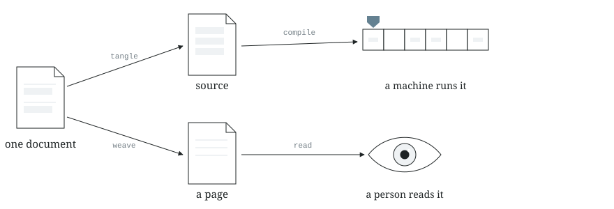
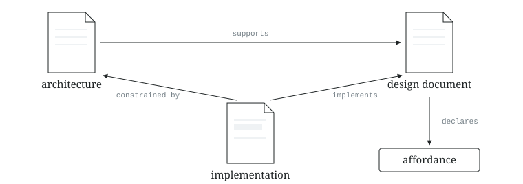
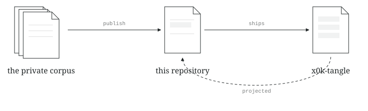

<!-- @generated by x0k-tangle (pipeline: identity-tangle) from corpora/x0k/publications/x0k-folio/x0k-folio.md — DO NOT EDIT. -->
<picture>
  <source media="(prefers-color-scheme: dark)" srcset="assets/diagrams/plate-dark.svg">
  
</picture>

Folio turns a folder of Markdown into a typed, checked graph: documents
declare what they are and how they relate, own or quote code, and can be
queried and published as a set.

Documentation drifts away from the code it describes, and from the other
documents it names, because nothing checks one against the other. Folio adds
that check to CI, for the parts of your documentation you opt in. It is
before 1.0; [Status](#status) says what is released and what is not done yet.

## What you (or your agent) can do with this

<picture>
  <source media="(prefers-color-scheme: dark)" srcset="assets/diagrams/derive-dark.svg">
  
</picture>

The smallest case is one document that holds a program and its explanation:
**tangling** writes its code blocks out as source files, and **weaving**
renders the same document as a page to read. The rest works on documents
that say what they are, so the tools can check them as a set:

- <picture><source media="(prefers-color-scheme: dark)" srcset="assets/icons/tangle-source-from-a-document-dark.svg"></picture> **[Project source code out of a document](decisions/design/corpus/literate-programming/project-source-code-out-of-a-document.md)**

  <p>Collect a document's code blocks into source files a compiler can build.</p>

- <picture><source media="(prefers-color-scheme: dark)" srcset="assets/icons/weave-a-document-dark.svg"></picture> **[Read a document as the woven artifact](decisions/design/corpus/literate-programming/read-a-document-as-the-woven-artifact.md)**

  <p>Read the explanation and code together, with each reference to another code block a link to where that block is defined.</p>

- <picture><source media="(prefers-color-scheme: dark)" srcset="assets/icons/quote-code-from-its-source-dark.svg"></picture> **[Quote code you already have](decisions/design/corpus/literate-programming/quote-code-you-already-have.md)**

  <p>Quote a function or type from a source file, and be told when the quote no longer matches it.</p>

- <picture><source media="(prefers-color-scheme: dark)" srcset="assets/icons/check-a-document-against-shipped-vocabulary-dark.svg"></picture> **[Check a document against its vocabulary](decisions/design/corpus/publish-a-region-as-a-repository/check-a-document-against-its-vocabulary.md)**

  <p>Find metadata and relationships that do not match the document vocabulary.</p>

- <picture><source media="(prefers-color-scheme: dark)" srcset="assets/icons/query-the-documents-dark.svg"></picture> **[Query the documents](decisions/design/corpus/publish-a-region-as-a-repository/query-the-documents.md)**

  <p>Ask questions across a collection's concepts, instances, and relationships.</p>

And a set of documents can be [published](#a-set-to-publish) as a repository
of its own, as this one is.

An agent can do all of it for you: the documents are Markdown, the headers are
a few lines it writes, and the checks tell it when it got one wrong. The
[implementation map](IMPLEMENTATION.md) lists every capability with its
declaration and the tests that prove it.

## Getting started

### Does it fit?

Where to start depends on what your documents already are:

- **Decision records, design docs, an ADR directory.** Give each one a
  [header](#decision-records-and-design-docs) and let `check` fail CI when a
  header names a document that is not there; `query` lists what is current
  and what replaced what.
- **Docs that quote code.** [Mirror](#docs-that-quote-code) the quoted
  symbols, so a page that quotes a function fails CI when the function
  changes. Your code stays where it is.
- **Code whose explanation matters as much as the code.** Let the document
  [own it](#code-the-document-owns): its code blocks are the source, and the
  files are generated from them.
- **A set you want to publish.** Name its documents in a
  [publication](#a-set-to-publish), and `publish-repo` writes them as a
  repository of their own and pushes it.

If your documentation is a few pages that neither quote code nor name one
another, there is nothing here for Folio to check, and you do not need it.

If you evaluate tools with an agent, this prompt starts it in the right
places:

```
Read https://github.com/0k-dot-computer/x0k-folio, starting with README.md and
guides/INTEGRATING.md. Look at my project. Where would typed documents or code
generated from documents be useful? Name a specific place to start, show
a small example, and explain the cost of keeping it up to date.
```

### Install

```sh
curl -fsSL https://0k.computer/folio/install.sh | sh
```

This installs `x0k-tangle` and `x0k-folio-cli` for Linux or macOS (x86_64 or
arm64) from [the latest release](https://github.com/0k-dot-computer/x0k-folio/releases),
checking each archive against the release's `SHA256SUMS` before anything is
written. The address is this project's own domain and redirects to the
release's `install.sh`; to do the same by hand, download your platform's
archive and `SHA256SUMS` from the release page and run `shasum -a 256 -c`.
On Windows, take the `.zip` from the release page. With a Rust toolchain,
`cargo install x0k-tangle` builds the tangler from crates.io instead.
[Setup](guides/INTEGRATING.md#setup) covers pinning a version, verifying build
provenance, and building from source.

### Try it on one document

To see the mechanism before you touch your project, write this whole
document as `docs/occlusion.md` in an empty folder:

````markdown
# Ambient occlusion

```turtle folio:document
implementation:occlusion a x0k:Implementation ;
    x0k:status "accepted" ;
    folio:tangleRoot "src/occlusion.js" .
```

The visibility term is the mean of the samples the sampler returned.

```js {#average}
export function occlusion(samples) {
  return samples.reduce((a, b) => a + b, 0) / samples.length;
}
```

The type declarations are written here too, beside the function they
describe, and land in a file of their own:

```ts {#types file="src/occlusion.d.ts"}
export declare function occlusion(samples: number[]): number;
```
````

Then tangle it:

```sh
x0k-tangle tangle docs/occlusion.md --workspace .
```

It writes `src/occlusion.js` and `src/occlusion.d.ts`, each opening with a
`@generated` header in that file's own comment style, plus a
`docs/occlusion.tangle-map.json` sidecar recording which chunk produced which
file. `x0k-tangle weave docs/occlusion.md --output-dir site` renders the same
document as a page.

One document, two files, two languages. The declarations and the code they
declare cannot fall out of step, because there is one place to edit them and
the other file is output. Nothing about it is specific to TypeScript, and
nothing about it is specific to Rust either — the tools are Rust, the
documents are whatever you write.

The same thing at full size is every chapter under
[`implementation/`](implementation): [The chunk shape](implementation/tangle/chunk.md),
for one, is the document that generates part of the tangler you just ran.

### Bring it into your project

A folder adopts one document at a time. A file with no header is left out of
the header checks and counted — its mirrors and chunks are still checked — so
start with one document and run `x0k-tangle check docs` on the folder it is in.

Each way in comes down to a command CI runs:

| What | Command | Fails when |
|---|---|---|
| Docs that quote code stay current | `x0k-tangle sync <path…>`, then `check` | a mirror no longer matches the source it quotes |
| Code written inside the document that explains it | `x0k-tangle tangle <doc>`, then `git diff --exit-code` | a generated file no longer matches its document |
| Headers and links checked against a vocabulary | `x0k-tangle check <dir>` | a class, an edge or a literal statement whose term the vocabulary does not declare, in a header or a graph block; a literal its datatype contradicts |
| A CI gate on a closed set | `x0k-tangle check <dir> --closed` | an edge names a document that is not in the set, such as a rename nobody finished |
| Questions across the set | `x0k-folio-cli ingest`, then `query --named status` or `--named superseded` | — (lists every document's status, or each replaced decision and what replaced it, read from `x0k:supersededBy` edges) |
| A set published as its own repository | `x0k-tangle publish-repo <publication> --output-dir <dir>` rehearses and pushes nothing; add `--really` to push | the publication names a document nothing declares, states no licence, or publishes a crate that depends on one it does not publish |

The header is a fenced block, so a site generator shows it as one. GitHub
and Docusaurus render it, and every mirror, as an ordinary code block with no
setup. MkDocs needs the one-file hook every release ships,
`tools/mkdocs_folio.py`, added under `hooks:` in `mkdocs.yml`; with it the
blocks render under `pymdownx.superfences` or plain `fenced_code`, and a page
can hide its header. [What was tested, on which
versions](guides/INTEGRATING.md#typing-your-documents-in-place).

#### Decision records and design docs

Give each document a header — one Turtle block under its title — saying what
it is and how it relates to the others:

````markdown
# Retry budget

```turtle folio:document
decision:retry-budget a x0k:Decision ;
    x0k:status "superseded" ;
    x0k:supersededBy decision:retry-budget-v2 .
```
````

`x0k-tangle check docs --closed` fails when a header names a document that is
not in the folder, such as after a rename nobody finished. `x0k-folio-cli
ingest`, then `query --named status`, lists every document's status, and
`--named superseded` lists what replaced what.
[Typing your documents in place](guides/INTEGRATING.md#typing-your-documents-in-place)
walks through a whole directory, and
[Asking the collection a question](guides/INTEGRATING.md#asking-the-collection-a-question)
through queries of your own.

#### Docs that quote code

A document can quote code it does not own. Name the file and the symbol, and
leave the block empty:

````markdown
The budget refills on every successful call:

```rust {#refill from="src/budget.rs" symbol="Budget::refill"}
```
````

From the project root, `x0k-tangle sync docs` fills the block from the source,
and `x0k-tangle check docs` fails once the two differ, so a page cannot go on
showing code the tree no longer has. A mirror needs no header: it works in any
Markdown file. Symbols resolve in
Rust, TypeScript, JavaScript and TSX, Python, and Julia.
[Starting from code you already have](guides/INTEGRATING.md#starting-from-code-you-already-have)
covers methods, decorated items and the other path forms.

#### Code the document owns

Write the code inside the document, as in [the example](#try-it-on-one-document),
and commit the document, the sidecar and the generated files together. Have CI
re-tangle and fail if the tree changes. That check is the whole reason the
prose stays true to the code; without it you have comments again.
[Adopting the tangle for one crate](guides/INTEGRATING.md#adopting-the-tangle-for-one-crate)
moves an existing module into a document.

#### A set to publish

A **publication** is a document that names other documents and the code they
own. `x0k-tangle publish-repo <publication> --output-dir <dir>` writes them as
a standalone repository and rehearses the push; `--really` pushes it.
[Publishing a collection](guides/INTEGRATING.md#publishing-a-collection) is the
walkthrough.

## Status

- **Releases:** [GitHub releases](https://github.com/0k-dot-computer/x0k-folio/releases),
  each with platform binaries, `SHA256SUMS`, build provenance and a source
  tarball that rebuilds offline; what changed is in [`CHANGELOG.md`](CHANGELOG.md).
- **crates.io:** `x0k-tangle` and the library crates it builds on.
  `x0k-folio-cli` is not on crates.io, because its storage adapter depends on
  [Dialog](https://github.com/dialog-db/dialog-db) by git revision; it ships
  in the release binaries and installs with `cargo install --git`.
- **Platforms:** the install script covers Linux and macOS on x86_64 and arm64;
  Windows has a release `.zip`. Building from source needs Rust 1.89 or later
  and a C compiler, for the tree-sitter grammars.
- **Stability:** before 1.0, a minor version may change the library crates'
  APIs; the changelog names each such change.
- **Contributing:** issues and pull requests go to this repository. Most files
  here are generated from Markdown sources that are edited upstream, so a
  change to one of them is applied there and returns with the next release;
  [`guides/CONTRIBUTING.md`](guides/CONTRIBUTING.md) says which files are
  edited here directly.
- **Not done yet:** [what these tools do not do yet](guides/INTEGRATING.md#what-does-not-exist-yet).

## How it works

This repository is written the way it asks you to write. Every part of the
tools is a chapter under `implementation/` that generates the code in
`crates/`, and the [implementation map](IMPLEMENTATION.md) groups the chapters
by idea. Each section below ends at the group to read next.

### Tangling and weaving

A code block with a name, `{#average}`, is a **chunk**. A chunk lands in the
file its `file=` attribute names, or else in the file the header's
`folio:tangleRoot` names. Chunks also splice: a line reading `<<average>>`
inside another block pastes the `average` block in there, at the reference's
own indentation. So you choose the order that explains the program, and the
compiler still receives the order it needs. Every generated file opens with a
`@generated` header naming its document, and the sidecar records which chunk
produced which lines.

Weaving goes the other way: the same document rendered as a page, each chunk
reference a link to its definition.
Next: [Chunks, and resolving them](IMPLEMENTATION.md#chunks-and-resolving-them)
and [Weaving a document into something to read](IMPLEMENTATION.md#weaving-a-document-into-something-to-read).

### Mirrors

A mirror names a file and a symbol. `sync` parses the file with the
tree-sitter grammar for its language and copies the whole item the symbol
names; the grammar decides where the item begins and ends, so there is no
brace counting and no regular expression. `check` repeats the extraction and
compares. Next: [Back the other way](IMPLEMENTATION.md#back-the-other-way).

### Typed documents

Each document's header gives it an identity, a kind, and named relationships
to other documents. An implementation can name the design it follows; a
design can name the decision that supports it; a decision can name the one
that replaced it. In the header above, the subject is the document, `a` names
its class, and every other line is a statement in the vocabulary's own terms:
`x0k:supersededBy` is the property the vocabulary file declares, spelled the
same way, and `decision:` is a prefix you get without declaring it, one per
class the vocabulary has.

`check` validates headers against the shipped vocabulary, or yours:
`--vocabulary <dir>` adds your own modules, and
[a six-line module](guides/INTEGRATING.md#the-smallest-module-of-all) gives
your documents ids under a prefix of your own, such as `acme:`. Out of the box
an edge to a document outside the scanned folder is a note, not a failure,
because a collection is usually part of something larger; `--closed` is for
the tree that is the whole set.

<picture>
  <source media="(prefers-color-scheme: dark)" srcset="assets/diagrams/triangle-dark.svg">
  
</picture>

Next: [What a document is](IMPLEMENTATION.md#what-a-document-is) and
[The vocabulary a document is written in](IMPLEMENTATION.md#the-vocabulary-a-document-is-written-in).

### Vocabularies

The vocabulary is RDF. Its concepts are OWL classes, and a document can define
concepts of its own in a `turtle folio:graph` block and describe particular
things with them in more graph blocks, one thing per section — the heading is
its title and the prose its description.
[`crates/x0k-folio-cli/examples/papers/`](crates/x0k-folio-cli/examples/papers)
is a small collection that does both — a `paper:` namespace and a `Paper`
class, and two papers citing each other — to copy as a start.
[Explore the supplied vocabulary](assets/diagrams/vocabulary.svg).
Next: [Querying documents](IMPLEMENTATION.md#querying-documents).

### Publications, and this repository

A publication selects documents and code from a larger collection and
produces a standalone repository, recording their origins in
`PROVENANCE.json`. This repository is one. It carries the tangler that
generated its code, with that tangler's source documents in
`implementation/`, and the projector that selected and wrote it. This README
is generated the same way, from a document that stays in the larger
collection. `x0k-tangle project-repo` writes a publication of your own
collection, `publish-repo --really` pushes it to your git remote, and
`receive-repo` turns a contributor's clone back into patches against your
documents. The reader website we weave our own publications into is not here.

<picture>
  <source media="(prefers-color-scheme: dark)" srcset="assets/diagrams/circle-dark.svg">
  
</picture>

Next: [Publishing a collection](IMPLEMENTATION.md#publishing-a-collection).

## License

MIT ([`LICENSE-MIT`](LICENSE-MIT)). Dependencies keep their own terms,
listed with the [implementation map](IMPLEMENTATION.md#license).

[Implementation](IMPLEMENTATION.md) · [Integration](guides/INTEGRATING.md) ·
[Contributing](guides/CONTRIBUTING.md) · [Background and prior work](IMPLEMENTATION.md#lineage) ·
[MIT license](LICENSE-MIT)
